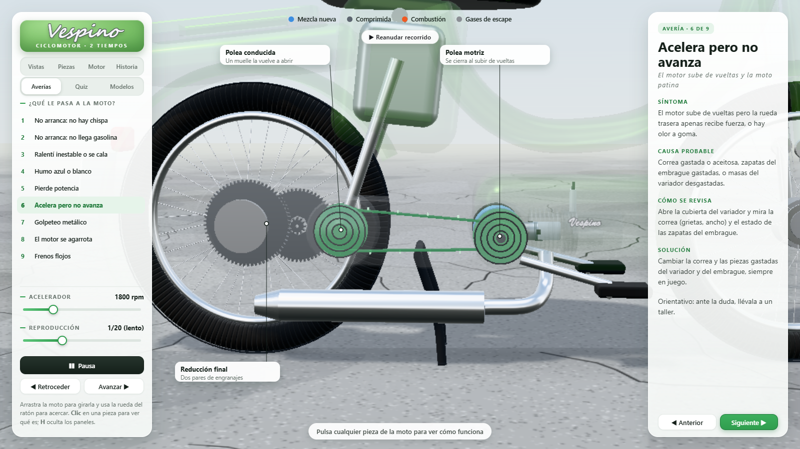

# Vespino 3D

Maqueta 3D interactiva de un **Vespino** (el ciclomotor español de dos tiempos fabricado en Madrid por Moto Vespa S.A.). Es una sola página HTML que funciona **sin internet**: se abre con doble clic.

> 💚 **Hecho con la skill [teardown](https://github.com/elvarofficial/teardown) de [@elvarofficial](https://github.com/elvarofficial).** Todo el simulador (escena, cortes, recorrido automático) nace de su trabajo. ¡Muchísimas gracias, es una pasada! Más abajo, en [Agradecimientos](#agradecimientos).


## Cómo abrirla

**En la web:** https://itsjulii23.github.io/vespino/

**En tu ordenador:** descarga `vespino-3d.html` y ábrela en Chrome, Edge o Firefox. No hay que instalar nada.

## Qué se ha creado

Todo el modelo está generado por código con [three.js](https://threejs.org), sin modelos 3D descargados:

- **Carrocería de chapa** con el espinazo central, guardabarros, sillín en forma de pera, portabultos y faro.
- **Motor de dos tiempos de 49,8 cc** con pistón, biela, cigüeñal, cilindro, carburador y escape, que se mueven con la cinemática real de biela-manivela.
- **Variador de correa** con poleas, muelle y embrague centrífugo, y la reducción final por engranajes.
- **Escena** con asfalto, sombras, niebla y un cielo que se refleja en la pintura.

### Siete pestañas

| Pestaña | Qué hace |
| --- | --- |
| **Vistas** | Seis cámaras, tres cortes (sólido, cristal, sección), rótulos, gases, recorrido automático, **modo conducción** y **sonido** del motor. |
| **Piezas** | 43 piezas desmontables. Clic para ver su ficha, doble clic para quitarla y deslizador de despiece. |
| **Motor** | Lección de 9 temas del motor de dos tiempos. Cada carrera del pistón se repite en bucle y en cámara lenta junto a su explicación. |
| **Historia** | Línea de tiempo del Vespino (1967–2000) y de la marca. |
| **Averías** | 9 averías típicas (no arranca, humo, patina, golpeteo…) con síntomas, causa, cómo se revisa y solución; las piezas implicadas se iluminan. |
| **Quiz** | «Adivina la pieza» y «Monta la moto»: la moto empieza desmontada y hay que colocar 14 piezas en el orden correcto. |
| **Modelos** | 13 modelos reales (Vespino, Brisa, Rally, Tour, T, NL, SC, AL, XE, Telepizza…) y cambio de color y accesorios. |




## Despiece completo

La moto entera desmontada: carrocería, dirección, ruedas, motor, transmisión y escape. En la maqueta se controla con el deslizador **Despiece** o quitando las piezas una a una.


📖 **[Catálogo de las 43 piezas](docs/PIEZAS.md)**, cada una con qué hace, cómo funciona, un dato y las piezas relacionadas.

### Más capturas


## Cómo usarla

- **Arrastrar** gira la moto; la **rueda del ratón** acerca y aleja.
- **Clic** en una pieza abre su ficha; **doble clic** la quita; **Esc** vuelve a la vista general.
- **1 a 6** cambian de cámara; **H** oculta los paneles.
- La dirección web se actualiza al elegir una pieza o una pestaña (por ejemplo `#pieza=carter` o `#tab=m`): copia el enlace para compartirla.
- En pantallas pequeñas los paneles se ocultan y aparece un botón **☰ Menú**; el diseño está pensado para ordenador.
- Los deslizadores controlan el acelerador y la velocidad de reproducción (puedes ir a cámara lenta).

## Rendimiento

La página mide sus fotogramas y baja sola la calidad (cuatro niveles: sombras que se redibujan cada pocos fotogramas, menos resolución y suavizado) en equipos con gráfica integrada. Las piezas nuevas no añaden geometría pesada y el sonido es sintetizado por código, sin archivos.

## Estructura del código

```
vespino-3d.html     la maqueta compilada (un solo archivo)
vespino-sim/
  kin.js            cinemática del motor y de la transmisión
  bike.js           el modelo 3D y el sistema de piezas
  parts.js          las 43 piezas y sus fichas
  motor.js          los temas de la pestaña Motor
  learn.js          averías, modelos y colores
  history.js        la línea de tiempo
  stage.js          escena, luces, sombras y calidad
  console.js        la interfaz
  live.js           la interacción
  main.js           punto de entrada
```

## Cómo recompilarla

Se construye con la skill [teardown](https://github.com/elvarofficial/teardown) (necesita Node 20 o superior):

```
node "<ruta-de-teardown>/sims/build.mjs" ./vespino-sim
```

El resultado queda en `teardown-out/dist/vespino-sim.html`.

## Datos y fuentes

- Las **fechas, modelos y cifras históricas** proceden de [Wikipedia](https://es.wikipedia.org/wiki/Motovespa_Vespino), [vespinos.org](https://vespinos.org/historia-del-vespino/) y [Motorpasión Moto](https://www.motorpasionmoto.com/scooter/el-mitico-vespino-cumple-50-anos-el-ciclomotor-que-se-viralizo-en-espana). Las fuentes no coinciden del todo en algunas fechas.
- Cilindrada (49,77 cm³), diámetro por carrera (38,4 × 43 mm), potencia y consumo vienen de esas fuentes.
- La **reducción final 22:1, los radios del variador y el régimen del embrague son estimaciones**, no datos del manual.
- Los **textos de las piezas** están escritos con conocimientos generales de motores de dos tiempos.
- Es una aproximación visual: la forma, la posición del depósito y los despieces no son un plano oficial.

## Agradecimientos

Gracias a **[elvarofficial](https://github.com/elvarofficial)** por la skill [teardown](https://github.com/elvarofficial/teardown), que ha hecho posible esta maqueta: el motor de escena, las capturas, el recorrido automático y la estructura de simulador salen de su trabajo. ¡Un trabajazo! 🙌

La skill, a su vez, se apoya en [claude-motion](https://github.com/whaleyxbt/claude-motion) (MIT).

## Aviso

Proyecto personal y educativo, sin relación con Piaggio ni con Moto Vespa S.A. «Vespino» y «Vespa» son marcas de sus propietarios.
