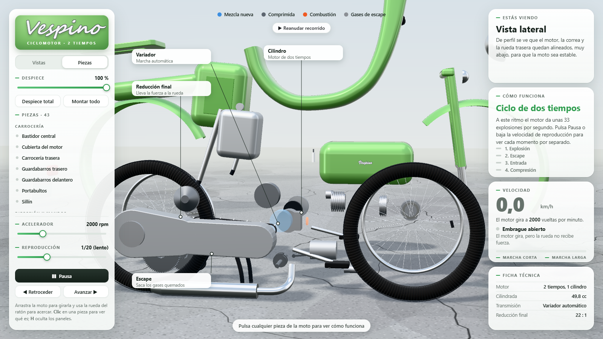
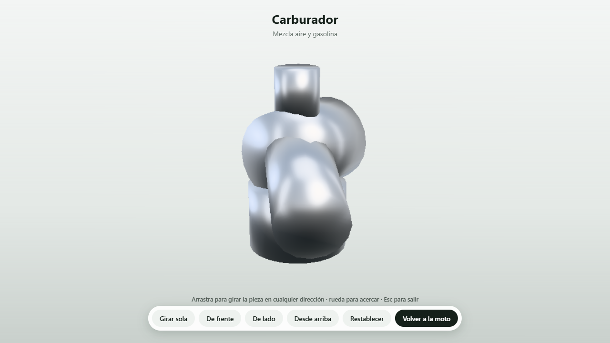
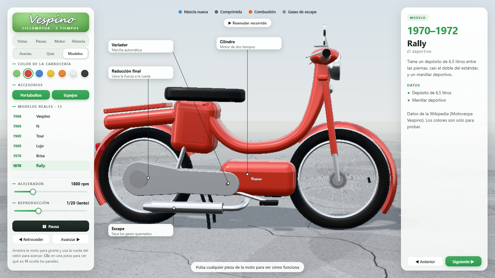

# Vespino 3D

**Un Vespino Mortadelo en 3D que puedes girar, desmontar pieza a pieza y poner en marcha, desde el navegador y sin instalar nada.**

[**▶ Abrir la maqueta**](https://itsjulii23.github.io/vespino/) · [Qué puedes hacer](#qué-puedes-hacer) · [Cómo se maneja](#cómo-se-maneja) · [Cómo está hecho](#cómo-está-hecho) · [Mis skills](#mis-skills)


Si has crecido en España, es difícil que no te suene el Vespino: el ciclomotor que se oía antes de verlo, el que llevaba medio país al instituto o a la obra. Yo quería saber qué tenía dentro, así que lo he desmontado. Sin llaves ni aceite: en 3D, con el motor funcionando.

Todo cabe en una sola página HTML que funciona sin internet. También puedes descargar [`vespino-3d.html`](vespino-3d.html) y abrirla con doble clic en Chrome, Edge o Firefox.

> **Antes que nada, gracias a [@elvarofficial](https://github.com/elvarofficial).** La maqueta está hecha con su skill [teardown](https://github.com/elvarofficial/teardown): la escena, los cortes, el recorrido automático y toda la base del simulador vienen de ahí. Sin su trabajo esto no existiría. Hay más en [Agradecimientos](#agradecimientos).

## Qué puedes hacer

### Desmontarlo

La moto es el primer Vespino, el de 1968 al que todo el mundo llama **Mortadelo**. Tiene 43 piezas y cada una se puede quitar, mirar de cerca y leer para qué sirve. Si arrastras el deslizador de **Despiece**, se abre entera en el aire.



Si una pieza te llama la atención, en su ficha tienes el botón **Examinar en 3D**: la saca sola a pantalla completa y la puedes girar como quieras, igual que si la tuvieras en la mano.



### Arrancarlo

- **Puño del acelerador** (abajo a la derecha): arrástralo hacia arriba y el motor sube de vueltas. Cuanto más lo giras, más fuerte suena. Al soltarlo vuelve solo al ralentí, como uno de verdad.
- **Sonido**: no es una grabación, es un modelo de cómo hace ruido un dos tiempos. Dispara una vez por vuelta, el escape y el silenciador le dan su timbre, a ralentí va a golpes irregulares (el «ponpón» de siempre) y con el gas abierto se afina y se abre.
- **Humo del escape**: sale a bocanadas, al ritmo de las explosiones. Si aceleras sale más espeso, y si vas en marcha se queda atrás.
- **Luces**: el botón **Luces** enciende el faro, que ilumina el suelo, y el piloto de atrás.
- **Conducción**: la moto sale de la tienda a la carretera y el variador va cambiando de marcha solo.

El motor no está de adorno. El pistón, la biela y el cigüeñal se mueven con la cinemática real, y el variador abre y cierra sus poleas según lo que aceleres.

### Aprender

| Pestaña | Qué vas a encontrar |
| --- | --- |
| **Vistas** | Seis cámaras, cortes para ver por dentro, un recorrido automático, conducción, sonido y luces. |
| **Piezas** | Las 43 piezas. Un clic abre su ficha y doble clic la quita. |
| **Motor** | Nueve lecciones sobre cómo funciona un dos tiempos, con el pistón a cámara lenta mientras lees. |
| **Historia** | La vida del Vespino de 1967 a 2000. |
| **Averías** | Nueve averías de toda la vida (no arranca, echa humo, patina…), con cómo detectarlas y arreglarlas. Las piezas implicadas se iluminan. |
| **Quiz** | «Adivina la pieza» y «Monta la moto»: empiezas con la moto desmontada y tienes que montarla en orden. |
| **Modelos** | 13 modelos reales, del primer Vespino al de Telepizza, y cambio de color y accesorios. |

¿Prefieres leer sin abrir la maqueta? Aquí está el **[catálogo de las 43 piezas](docs/PIEZAS.md)**.

<details>
<summary>Más capturas</summary>





</details>

## Cómo se maneja

| Quieres… | Haz esto |
| --- | --- |
| Girar la moto | Arrastra con el ratón |
| Acercarte o alejarte | Rueda del ratón |
| Ver qué es una pieza | Clic sobre ella |
| Quitar una pieza | Doble clic (o «Quitar pieza» en su ficha) |
| Volver a ver toda la moto | **Esc** |
| Cambiar de cámara | Teclas **1** a **6** |
| Encender las luces | Tecla **L** |
| Dar gas | Arrastra el puño, o las flechas ↑ ↓ |
| Esconder los paneles | Tecla **H** |

Si eliges una pieza o una pestaña, la dirección de la página cambia (por ejemplo `#pieza=carter`), así que puedes mandarle a alguien justo lo que estás viendo. En el móvil los paneles van detrás de un botón **☰ Menú**, aunque donde mejor se ve es en el ordenador. Si tu ordenador va justo, la página lo nota y baja la calidad sola para no ir a saltos.

## La web

La maqueta vive dentro de una web hecha con Angular (carpeta [`web/`](web)): una portada con la historia y la ficha técnica, y la ruta `/maqueta` con el simulador a pantalla completa. Se publica sola en GitHub Pages con cada cambio en `main`.

```
cd web
npm install
npm start        # servidor local
npm test -- --watch=false
```

El simulador no se toca: `npm start` y `npm run build` copian `vespino-3d.html` a `web/public/sim/`.

## Cómo está hecho

### El Mortadelo en Blender

Al principio la moto estaba hecha toda por código y se parecía a un Vespino… más o menos. Ahora la carrocería, la dirección, el motor por fuera, el escape y los pedales salen de un modelo de Blender del Mortadelo.


Las medidas son las de la ficha técnica: 1130 mm entre ejes, 1760 de largo, 610 de ancho, 1040 de alto y ruedas de 2¼ × 18 pulgadas. La forma la saqué de la foto de perfil del catálogo original, escalada con esas medidas. El modelo mide 1734 × 617 × 1043 mm, a menos de un 2 % de la ficha.

Como no me fiaba de mi ojo, cada pieza se compara con la foto: Blender la dibuja en silueta desde el mismo ángulo y se mide cuánto coincide. Casi todas pasan del 90 %. Y tiene detalles que antes no había: los 36 radios de cada rueda, el dibujo del neumático, las aletas del cilindro, la tapa de la correa con sus rejillas y el rótulo «Vespino», los puños estriados o el velocímetro Veglia.

Las piezas que se mueven (pistón, biela, cigüeñal, poleas, correa, engranajes y ruedas) siguen hechas por código, porque las mueve la cinemática del motor. Eso sí, ahora están donde van en el Mortadelo.

La moto entera sale de scripts: si quiero cambiar una pieza, toco el script y la vuelvo a generar. Así fue, por ejemplo, como pasé el espejo al lado izquierdo, que es donde va.

### La tienda

La moto está aparcada en una tienda parecida a la de las fotos que usé de referencia: suelo de baldosa clara, un trozo de baldosa hidráulica, pared gris azulada con cuadros, una escalera con barandilla y una papelera. Está todo dibujado por código; no uso esas fotos ni sus carteles.

### Estructura del proyecto

```
vespino-3d.html     la maqueta compilada (un solo archivo)
vespino-sim/        el código de la maqueta
  kin.js            cómo se mueven el motor y la transmisión
  bike.js           el modelo 3D, las piezas y las luces
  mortadelo.js      carga el modelo de Blender (mortadelo.glb)
  parts.js          las 43 piezas y sus fichas
  motor.js          las lecciones del motor
  learn.js          averías, modelos y colores
  history.js        la línea de tiempo
  stage.js          escena, luces y calidad
  shop.js           la tienda donde está aparcada
  smoke.js          el humo del escape
  engine-sound.js   el sonido del motor
  grip.js           el puño del acelerador
  inspect.js        el visor para examinar una pieza
  console.js        la interfaz
  live.js           la interacción
  main.js           el punto de entrada
  tests/            pruebas
.claude/skills/     la skill de la maqueta (vespino-maqueta)
```

### Compilarlo y probarlo

Hace falta la skill [teardown](https://github.com/elvarofficial/teardown) y Node 20 o superior:

```
node "<ruta-de-teardown>/sims/build.mjs" ./vespino-sim
node --test vespino-sim/tests/glb.test.mjs vespino-sim/tests/sound.test.mjs vespino-sim/tests/page.test.mjs
```

La compilación sale en `teardown-out/dist/vespino-sim.html`. El modelo va metido dentro del HTML, por eso la página sigue funcionando sin internet.

## Mis skills

El modelado en Blender vive en otra carpeta del proyecto (`Vespino`, rama `main`) junto con sus skills. Aquí queda la skill [vespino-maqueta](.claude/skills/vespino-maqueta/SKILL.md): cómo carga la maqueta el modelo, las cotas, los materiales, y cómo compilarla y probarla.

## De dónde salen los datos

He intentado no inventarme nada, pero es justo que sepas qué es dato y qué es aproximación:

- Las fechas, los modelos y la historia vienen de [Wikipedia](https://es.wikipedia.org/wiki/Motovespa_Vespino), [vespinos.org](https://vespinos.org/historia-del-vespino/) y [Motorpasión Moto](https://www.motorpasionmoto.com/scooter/el-mitico-vespino-cumple-50-anos-el-ciclomotor-que-se-viralizo-en-espana). En alguna fecha no se ponen de acuerdo entre ellas.
- La cilindrada (49,77 cc), el diámetro y la carrera (38,4 × 43 mm) y las medidas del Mortadelo vienen de esas fuentes y de la ficha de [vespinos.org](https://vespinos.org/vespinos-con-valvula-rotativa/).
- La reducción final, el tamaño de las poleas del variador y las revoluciones del embrague son estimaciones mías, no datos del manual.
- Los textos de las piezas están escritos con lo que se sabe en general de los motores de dos tiempos.
- En el modelo de Blender, lo que no se ve en las fotos (el interior del motor, la parte de atrás) está colocado según la ficha y la lógica mecánica.

## Agradecimientos

Otra vez, gracias a **[elvarofficial](https://github.com/elvarofficial)** por la skill [teardown](https://github.com/elvarofficial/teardown). El motor de escena, las capturas, el recorrido automático y la forma de montar el simulador son suyos. Un trabajazo. Esa skill, a su vez, usa [claude-motion](https://github.com/whaleyxbt/claude-motion) (licencia MIT).

Y gracias a la gente de [vespinos.org](https://vespinos.org), [vespinos.com](https://www.vespinos.com), [Vespinarium](http://vespinarium.blogspot.com) y [gaviras.com](https://gaviras.com). Comparten fotos y fichas de sus Vespinos, y sin ellas el modelo de Blender no habría sido posible.

## Aviso

Es un proyecto personal y educativo, sin relación con Piaggio ni con Moto Vespa S.A. «Vespino» y «Vespa» son marcas de sus dueños.
