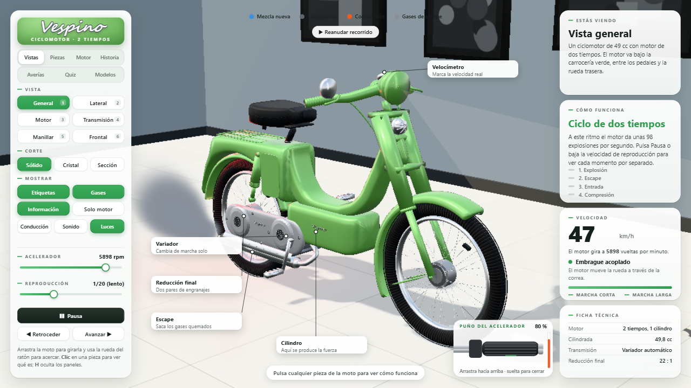
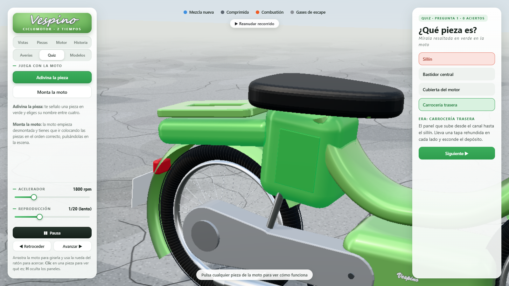
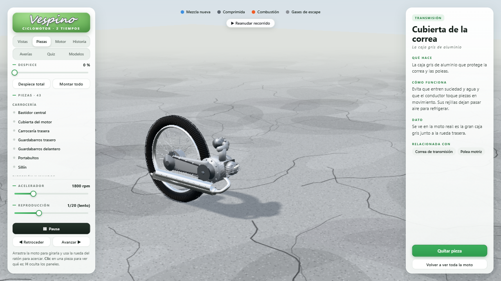
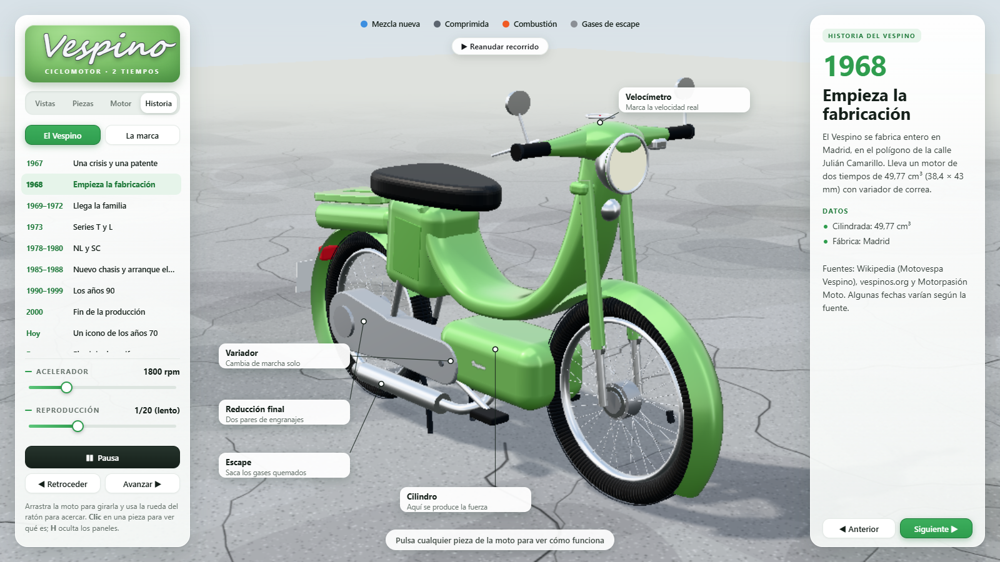

# Vespino 3D

Si has crecido en España, seguro que has visto (o has tenido) un Vespino. Este proyecto es mi forma de desmontarlo pieza a pieza sin mancharme las manos de aceite: una maqueta 3D que puedes girar, abrir por dentro y ver funcionar.

Todo cabe en una sola página HTML que funciona sin internet. Le das doble clic y ya está.

> **Antes de nada, gracias a [@elvarofficial](https://github.com/elvarofficial).** La maqueta está construida con su skill [teardown](https://github.com/elvarofficial/teardown): la escena, los cortes, el recorrido automático y toda la estructura del simulador salen de ahí. Sin ese trabajo esto no existiría. Hay más en [Agradecimientos](#agradecimientos).


## Pruébala

- **En el navegador:** https://itsjulii23.github.io/vespino/
- **En tu ordenador:** descarga `vespino-3d.html` y ábrelo con Chrome, Edge o Firefox. No hace falta instalar nada.

## Qué puedes hacer con ella

La moto es el primer Vespino, el de 1968 al que muchos llaman **Mortadelo**, modelado en Blender con las medidas de su ficha (más abajo cuento cómo).

Lo que más me gusta es desmontarla. Tiene 43 piezas y cada una se puede quitar, mirar de cerca y leer para qué sirve. Si arrastras el deslizador de **Despiece**, la moto se abre entera en el aire.


Además del despiece, hay siete pestañas:

| Pestaña | Qué encontrarás |
| --- | --- |
| **Vistas** | Seis cámaras, cortes para ver por dentro, un recorrido automático, modo conducción y el sonido del motor. |
| **Piezas** | Las 43 piezas. Un clic abre su ficha, doble clic la quita. |
| **Motor** | Nueve lecciones sobre cómo funciona un dos tiempos, con el pistón moviéndose a cámara lenta mientras lees. |
| **Historia** | La vida del Vespino desde 1967 hasta 2000. |
| **Averías** | Nueve averías de las de siempre (no arranca, echa humo, patina…) con cómo detectarlas y arreglarlas. Las piezas implicadas se iluminan. |
| **Quiz** | «Adivina la pieza» y «Monta la moto», donde empiezas con la moto desmontada y tienes que montarla en orden. |
| **Modelos** | 13 modelos reales, del primer Vespino al de Telepizza, y cambio de color y accesorios. |


El motor no es decorativo: pistón, biela y cigüeñal se mueven con la cinemática real de biela-manivela, y el variador abre y cierra sus poleas según el acelerador.

## La moto en la tienda

La moto ya no está en un estudio vacío. Está aparcada en una tienda como la de las fotos que usé de referencia: suelo de baldosa clara, una zona de baldosa hidráulica, pared gris azulada con cuadros, una escalera con barandilla de acero y una papelera. Todo está dibujado por código, sin usar las fotos ni los carteles de la tienda. Cuando pulsas **Conducción**, la moto sale a la carretera.



- **Puño del acelerador** (abajo a la derecha): arrástralo hacia arriba para dar gas. Cuanto más lo giras, más vueltas coge el motor y más fuerte suena. Al soltarlo vuelve solo al ralentí, como uno de verdad. La primera vez que lo tocas se enciende el sonido.
- **Humo del escape**: sale de la punta del silenciador a golpes, al ritmo de las explosiones. Al acelerar sale más espeso. Cuando vas en marcha, el aire lo deja atrás.
- **Luces**: el botón **Luces** (o la tecla **L**) enciende el faro, que ilumina el suelo, y el piloto trasero.
- **Examinar en 3D**: en la ficha de cualquier pieza hay un botón que la saca sola a pantalla completa. Puedes girarla en cualquier dirección arrastrando, acercarte con la rueda, ponerla de frente, de lado o desde arriba, o dejar que gire sola.


Si quieres leer sobre las piezas sin abrir la maqueta, está el **[catálogo de las 43 piezas](docs/PIEZAS.md)**.

<details>
<summary>Más capturas</summary>








</details>

## Cómo se maneja

- **Arrastra** para girar la moto y usa la **rueda del ratón** para acercarte.
- **Clic** en una pieza para ver su ficha, **doble clic** para quitarla y **Esc** para volver.
- Las teclas **1 a 6** cambian de cámara, **L** enciende las luces y **H** esconde los paneles.
- La dirección de la página cambia al elegir una pieza o una pestaña (por ejemplo `#pieza=carter`), así que puedes copiar el enlace y compartir justo lo que estás viendo.
- En el móvil los paneles se esconden tras un botón **☰ Menú**, pero donde mejor se ve es en el ordenador.

Si tu ordenador va justo, la página lo nota y baja la calidad sola para que no vaya a saltos.

## El Mortadelo en Blender

Al principio la maqueta estaba hecha toda por código y su forma era aproximada. Ahora la carrocería, la dirección, el motor por fuera, el escape y los pedales salen de un modelo de Blender del Mortadelo.


Las medidas son las de la ficha técnica: 1130 mm entre ejes, 1760 mm de largo, 610 de ancho, 1040 de alto y ruedas de 2¼ × 18 pulgadas. La forma está calcada de la foto de perfil del catálogo original, escalada con esas medidas. El modelo mide 1734 × 617 × 1043 mm, a menos de un 2 % de la ficha.

Para no fiarme solo del ojo, cada pieza se compara con la foto: Blender la dibuja en silueta desde el mismo ángulo y se mide cuánto coincide. Casi todas las piezas pasan del 90 %. Tiene detalles que antes no había: los 36 radios de cada rueda, el dibujo del neumático, las aletas del cilindro, la tapa de la correa con sus dos rejillas y el rótulo «Vespino», los puños estriados o el velocímetro Veglia.

Las piezas que se mueven (pistón, biela, cigüeñal, poleas, correa, engranajes y ruedas) siguen hechas por código, porque las mueve la cinemática del motor, pero ahora están colocadas donde van en el Mortadelo.

- `blender/scripts/mortadelo_*.py`: la moto entera se genera con estos scripts. Si quiero cambiar una pieza, cambio el script y la vuelvo a generar.
- `blender/mortadelo.blend`: el archivo de Blender.
- `vespino-sim/mortadelo.glb`: las piezas que usa la maqueta (va metido dentro del HTML, así que sigue funcionando sin internet).
- `models/mortadelo.glb`: el modelo completo, las 43 piezas.

Más adelante quiero añadir otros modelos de Vespino.

## Por dentro

```
vespino-3d.html     la maqueta compilada (un solo archivo)
vespino-sim/        el código de la maqueta
  kin.js            cómo se mueven el motor y la transmisión
  bike.js           el modelo 3D y las piezas
  mortadelo.js      carga el modelo de Blender (mortadelo.glb)
  parts.js          las 43 piezas y sus fichas
  motor.js          las lecciones del motor
  learn.js          averías, modelos y colores
  history.js        la línea de tiempo
  stage.js          escena, luces y calidad
  shop.js           la tienda donde está aparcada
  smoke.js          el humo del escape
  grip.js           el puño del acelerador
  inspect.js        el visor para examinar una pieza
  console.js        la interfaz
  live.js           la interacción
  main.js           el punto de entrada
  tests/            pruebas (node --test vespino-sim/tests/*.test.mjs)
blender/            modelos de Blender y los scripts que los generan
models/             modelos exportados a GLB
```

Para volver a compilar la maqueta hace falta la skill [teardown](https://github.com/elvarofficial/teardown) y Node 20 o superior:

```
node "<ruta-de-teardown>/sims/build.mjs" ./vespino-sim
```

El resultado sale en `teardown-out/dist/vespino-sim.html`.

## De dónde salen los datos

He intentado no inventarme nada, pero conviene que sepas qué es dato y qué es aproximación:

- Las fechas, los modelos y la historia vienen de [Wikipedia](https://es.wikipedia.org/wiki/Motovespa_Vespino), [vespinos.org](https://vespinos.org/historia-del-vespino/) y [Motorpasión Moto](https://www.motorpasionmoto.com/scooter/el-mitico-vespino-cumple-50-anos-el-ciclomotor-que-se-viralizo-en-espana). En alguna fecha no se ponen de acuerdo entre ellas.
- La cilindrada (49,77 cc), el diámetro y la carrera (38,4 × 43 mm) y las medidas del Mortadelo vienen de esas fuentes y de la ficha de [vespinos.org](https://vespinos.org/vespinos-con-valvula-rotativa/).
- La reducción final, el tamaño de las poleas del variador y las revoluciones del embrague son estimaciones mías, no datos del manual.
- Los textos de las piezas están escritos con lo que se sabe en general de los motores de dos tiempos.
- En el modelo de Blender, lo que no se ve en las fotos (el interior del motor, la parte de atrás) está colocado según la ficha y la lógica mecánica.

## Agradecimientos

Otra vez, gracias a **[elvarofficial](https://github.com/elvarofficial)** por la skill [teardown](https://github.com/elvarofficial/teardown). El motor de escena, las capturas, el recorrido automático y la forma de montar el simulador son suyos. Un trabajazo.

La skill, a su vez, usa [claude-motion](https://github.com/whaleyxbt/claude-motion) (licencia MIT).

Y gracias a la gente de [vespinos.org](https://vespinos.org), [vespinos.com](https://www.vespinos.com), [Vespinarium](http://vespinarium.blogspot.com) y [gaviras.com](https://gaviras.com), que comparten fotos y fichas de sus Vespinos y sin las que el modelo de Blender no habría sido posible.

## Aviso

Es un proyecto personal y educativo, sin relación con Piaggio ni con Moto Vespa S.A. «Vespino» y «Vespa» son marcas de sus dueños.
