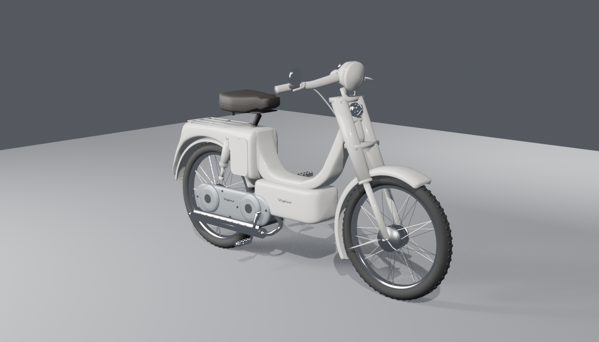

# Vespino 3D: el modelado

El **Vespino Mortadelo (1968)** modelado en Blender a partir de fotos de referencia y medidas oficiales. Aquí está el modelo, los scripts que lo generan y las skills de Claude Code que uso para hacerlo.

La web con la maqueta interactiva está en otra carpeta, `Vespino-web` (rama `web-angular` de este mismo repositorio, como worktree). Este modelo se exporta allí.



## Estructura

```
blender/            el modelo de Blender (.blend) y los scripts que lo generan
  scripts/          mortadelo_*.py (las piezas), vespino.py (ayudas), export_maqueta.py (exportación)
models/             modelos exportados a GLB (mortadelo.glb, las 43 piezas)
skills/             mi skill general de modelado desde fotos
.claude/skills/     la skill del Vespino (vespino-blender)
docs/               planes y especificaciones del modelado
referencias/        fotos de referencia de terceros (solo en local, no se suben)
```

## Cómo se trabaja

1. Abre `blender/mortadelo.blend` con Blender conectado a Claude por MCP.
2. Carga las ayudas (ver la skill `vespino-blender`). `vespino.py` saca la raíz del `.blend` y busca la web en `../Vespino-web`; si la tienes en otro sitio, define `VESPINO_WEB`.
3. Cambia el script de la pieza y vuelve a ejecutarlo; nunca se retoca la malla a mano.
4. Exporta con `export_maqueta()`: escribe `mortadelo.glb` dentro de `Vespino-web/vespino-sim/`. Compilar y probar la web se hace en esa carpeta.

## Mis skills

- **[blender-modelo-desde-fotos](skills/blender-modelo-desde-fotos/SKILL.md)**: la general, para modelar cualquier objeto real en Blender a partir de fotos y medidas oficiales.
- **[vespino-blender](.claude/skills/vespino-blender/SKILL.md)**: la de este proyecto: medidas del Mortadelo, nombres de pieza y cuándo darlas por buenas. Cómo instalarlas: [`skills/README.md`](skills/README.md).

## Aviso

Proyecto personal y educativo, sin relación con Piaggio ni con Moto Vespa S.A. «Vespino» y «Vespa» son marcas de sus dueños.
