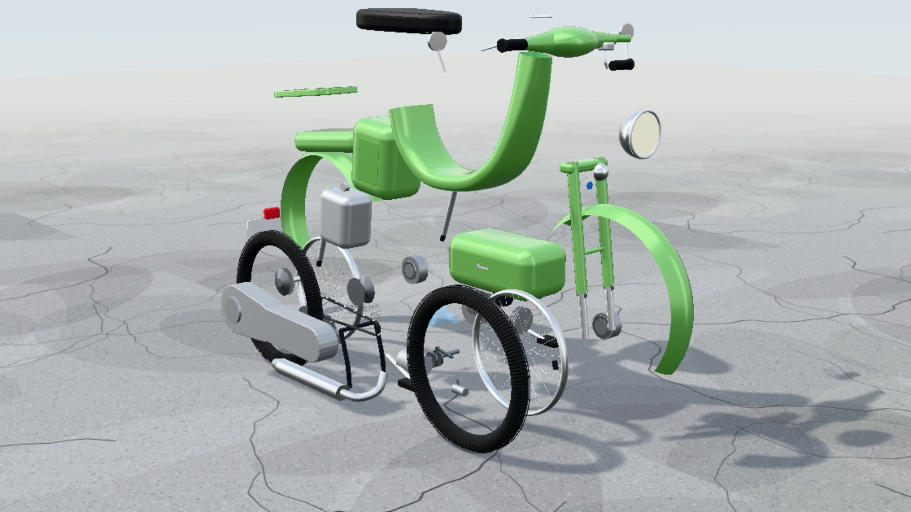

# Catálogo de piezas

Las 43 piezas de la maqueta, agrupadas por sistema. Cada una se puede ver, quitar y explicar dentro de la maqueta (pestaña **Piezas**).

> Los textos están escritos con conocimientos generales de ciclomotores de dos tiempos; no proceden del manual del Vespino. La forma y la posición de algunas piezas (por ejemplo el depósito) son aproximadas.

## Índice

- [Carrocería](#carroceria) (7)
- [Dirección y mandos](#direccion-y-mandos) (6)
- [Ruedas y frenos](#ruedas-y-frenos) (6)
- [Motor](#motor) (12)
- [Transmisión](#transmision) (7)
- [Escape y suspensión](#escape-y-suspension) (5)

## Carrocería

### Bastidor central

*La columna vertebral de la moto*

- **Qué hace:** Es el canal de chapa embutida que une la dirección con la parte trasera. Su forma abierta en U permite subir sin levantar la pierna.
- **Cómo funciona:** Soporta el peso del conductor y del motor y mantiene alineadas las dos ruedas. Al ser de chapa es ligero y barato de fabricar.
- **Dato:** Si lo quitas, el manillar y el tren trasero quedan sin unión.
- **Relacionada con:** Carrocería trasera, Horquilla, Cubierta del motor

### Cubierta del motor

*La caja que protege el motor*

- **Qué hace:** Cubre el motor y lleva el emblema Vespino cromado en cada lado.
- **Cómo funciona:** Evita que entren agua y suciedad y amortigua el ruido. Como el motor es pequeño, cabe entero bajo esta caja.
- **Dato:** Al quitarla se ven el cilindro, el cárter y el volante magnético.
- **Relacionada con:** Cárter del motor, Cilindro, Volante magnético

### Carrocería trasera

*El panel alto bajo el sillín*

- **Qué hace:** El panel que sube desde el canal hasta el sillín. Lleva una tapa rehundida en cada lado y esconde el depósito.
- **Cómo funciona:** Forma el cuerpo de la parte de atrás y se une al guardabarros y al portabultos en una sola pieza continua.
- **Dato:** Quítala para ver el depósito de combustible.
- **Relacionada con:** Depósito de combustible, Guardabarros trasero, Sillín

### Guardabarros trasero

*Cubre la rueda de atrás*

- **Qué hace:** Protege al conductor del agua y el barro que lanza la rueda, y sirve de base al piloto y a la matrícula.
- **Cómo funciona:** Es una pieza de chapa en arco, algo más ancha que el neumático. Va unida a la carrocería trasera.
- **Dato:** Su forma redondeada es una seña de identidad de las Vespa.
- **Relacionada con:** Carrocería trasera, Portabultos, Piloto trasero y matrícula

### Guardabarros delantero

*Cubre la rueda de delante*

- **Qué hace:** Cubre la rueda delantera y envuelve la parte alta del neumático por los lados.
- **Cómo funciona:** Va fijo a la horquilla, así que gira con la dirección. Su borde adelantado frena las salpicaduras.
- **Dato:** Una varilla fina lo une con el eje de la rueda para mantenerlo firme.
- **Relacionada con:** Horquilla, Neumático delantera

### Portabultos

*La bandeja trasera*

- **Qué hace:** Una bandeja con ranura para llevar bultos detrás del sillín.
- **Cómo funciona:** Se atornilla sobre el guardabarros trasero. La ranura lo aligera y sirve para pasar gomas o correas.
- **Dato:** Su borde elevado evita que los bultos resbalen.
- **Relacionada con:** Guardabarros trasero, Sillín

### Sillín

*El asiento del conductor*

- **Qué hace:** El asiento. Tiene forma de pera: estrecho delante para apoyar los pies y ancho detrás.
- **Cómo funciona:** Es una base de chapa con espuma y un forro negro. Se apoya sobre la carrocería trasera.
- **Dato:** Debajo queda el hueco donde va escondido el depósito.
- **Relacionada con:** Carrocería trasera, Portabultos

## Dirección y mandos

### Horquilla

*Sujeta la rueda delantera*

- **Qué hace:** Sujeta la rueda delantera y la une a la dirección. Gira con el manillar para tomar las curvas.
- **Cómo funciona:** Tiene dos tubos con un muelle que absorbe los baches. El eje de la rueda va en los extremos de abajo.
- **Dato:** Un puente superior mantiene los dos tubos paralelos.
- **Relacionada con:** Manillar y mandos, Llanta y radios delanteras, Guardabarros delantero

### Bocina

*Avisa a los demás*

- **Qué hace:** Avisa a peatones y otros vehículos. Se ve su rejilla cromada en la parte delantera de la dirección.
- **Cómo funciona:** Funciona con electricidad: una membrana vibra al pulsar el botón y produce el sonido.
- **Dato:** La rejilla es solo la tapa; el mecanismo va detrás.
- **Relacionada con:** Manillar y mandos, Volante magnético

### Manillar y mandos

*Con esto diriges y aceleras*

- **Qué hace:** Con él diriges la moto. En los puños van el gas, la maneta del freno y el interruptor de luces.
- **Cómo funciona:** Al girar el puño derecho tiras de un cable que abre el carburador. Las manetas tiran de cables que aprietan los frenos.
- **Dato:** Son cables Bowden: un hilo de acero dentro de una funda flexible.
- **Relacionada con:** Carburador, Buje y freno de tambor delantero, Espejos

### Espejos

*Para ver lo que viene detrás*

- **Qué hace:** Dos espejos retrovisores para ver lo que viene por detrás sin girar la cabeza.
- **Cómo funciona:** Son redondos y se orientan con una articulación en la base del brazo.
- **Dato:** Son obligatorios para circular.
- **Relacionada con:** Manillar y mandos

### Faro delantero

*La luz de delante*

- **Qué hace:** Ilumina el camino de noche y te hace visible de día. Va dentro de una copa cromada.
- **Cómo funciona:** Una bombilla detrás de un cristal. Recibe la corriente del volante magnético, así que brilla más cuando el motor gira más deprisa.
- **Dato:** Sin batería, si el motor se para el faro se apaga.
- **Relacionada con:** Volante magnético, Manillar y mandos

### Velocímetro

*Marca la velocidad*

- **Qué hace:** Indica la velocidad y los kilómetros recorridos. Va en lo alto del manillar.
- **Cómo funciona:** Un cable flexible lo conecta con una rueda y hace girar un imán; la aguja se mueve según la velocidad.
- **Dato:** En esta maqueta la aguja sigue la velocidad de la rueda simulada.
- **Relacionada con:** Manillar y mandos, Buje y freno de tambor delantero

## Ruedas y frenos

### Neumático trasera

*La goma que toca el suelo*

- **Qué hace:** Es lo único que une la moto con el asfalto. Da agarre y absorbe parte de los baches.
- **Cómo funciona:** El dibujo en bloques expulsa el agua de debajo del neumático. Es de sección estrecha, por eso la moto es ligera y fácil de manejar.
- **Dato:** Lleva una cámara de aire dentro, que se puede reparar si se pincha.
- **Relacionada con:** Llanta y radios traseras, Buje y freno de tambor trasero

### Llanta y radios traseras

*El aro cromado y sus 36 radios*

- **Qué hace:** El aro metálico que sostiene el neumático y los radios que lo unen al buje del centro.
- **Cómo funciona:** Los radios trabajan a tensión: tiran del aro hacia el centro y reparten el peso por toda la rueda. Es una estructura ligera y muy resistente.
- **Dato:** La tensión de cada radio se ajusta con una pequeña tuerca llamada niple.
- **Relacionada con:** Neumático trasera, Buje y freno de tambor trasero

### Buje y freno de tambor trasero

*El centro de la rueda y su freno*

- **Qué hace:** El centro de la rueda trasera. Recibe la fuerza del último engranaje y también lleva un freno de tambor.
- **Cómo funciona:** Al tirar de la maneta, un cable separa las zapatas, que presionan el interior del tambor y lo frenan. El rozamiento convierte el movimiento en calor.
- **Dato:** Va cerrado, así que el agua y el polvo le afectan poco.
- **Relacionada con:** Reducción final, Llanta y radios traseras

### Neumático delantera

*La goma que toca el suelo*

- **Qué hace:** Es lo único que une la moto con el asfalto. Da agarre y absorbe parte de los baches.
- **Cómo funciona:** El dibujo en bloques expulsa el agua de debajo del neumático. Es de sección estrecha, por eso la moto es ligera y fácil de manejar.
- **Dato:** Lleva una cámara de aire dentro, que se puede reparar si se pincha.
- **Relacionada con:** Llanta y radios delanteras, Buje y freno de tambor delantero

### Llanta y radios delanteras

*El aro cromado y sus 36 radios*

- **Qué hace:** El aro metálico que sostiene el neumático y los radios que lo unen al buje del centro.
- **Cómo funciona:** Los radios trabajan a tensión: tiran del aro hacia el centro y reparten el peso por toda la rueda. Es una estructura ligera y muy resistente.
- **Dato:** La tensión de cada radio se ajusta con una pequeña tuerca llamada niple.
- **Relacionada con:** Neumático delantera, Buje y freno de tambor delantero

### Buje y freno de tambor delantero

*El centro de la rueda y su freno*

- **Qué hace:** El centro de la rueda. Dentro hay un freno de tambor: dos zapatas que rozan el interior de un cilindro metálico.
- **Cómo funciona:** Al tirar de la maneta, un cable separa las zapatas, que presionan el interior del tambor y lo frenan. El rozamiento convierte el movimiento en calor.
- **Dato:** Va cerrado, así que el agua y el polvo le afectan poco.
- **Relacionada con:** Manillar y mandos, Horquilla

## Motor

### Cárter del motor

*La carcasa del cigüeñal*

- **Qué hace:** La carcasa de aluminio que encierra el cigüeñal. Es la parte baja del motor.
- **Cómo funciona:** En un dos tiempos el cárter no guarda aceite: hace de bomba. Al subir el pistón aspira la mezcla; al bajar la comprime y la envía al cilindro.
- **Dato:** Por eso debe cerrar sin ninguna fuga.
- **Relacionada con:** Cigüeñal, Cilindro

### Cilindro

*Donde sube y baja el pistón*

- **Qué hace:** El tubo por donde sube y baja el pistón. Tiene aletas por fuera para enfriarse con el aire.
- **Cómo funciona:** Tiene tres ventanas, las lumbreras: admisión, transferencia y escape. El propio pistón las abre y las cierra al moverse.
- **Dato:** No lleva válvulas: por eso un dos tiempos es tan simple.
- **Relacionada con:** Pistón, Culata, Tubo de escape

### Culata

*La tapa del cilindro*

- **Qué hace:** La tapa del cilindro. Cierra la cámara donde se quema la mezcla y lleva la bujía.
- **Cómo funciona:** Sus aletas disipan el calor de la explosión. La forma de la cámara junta la mezcla cerca de la bujía.
- **Dato:** Es la pieza que más calor soporta.
- **Relacionada con:** Bujía, Cilindro

### Bujía

*Hace la chispa*

- **Qué hace:** Produce la chispa que enciende la mezcla.
- **Cómo funciona:** Cuando el pistón llega arriba, una corriente de alto voltaje salta entre dos electrodos y enciende la mezcla comprimida.
- **Dato:** En un dos tiempos salta una chispa por cada vuelta.
- **Relacionada con:** Volante magnético, Culata

### Pistón

*Recibe el empuje de la explosión*

- **Qué hace:** La pieza que sube y baja dentro del cilindro y recibe el empuje de la explosión.
- **Cómo funciona:** Los segmentos sellan la holgura con el cilindro. Con su falda abre y cierra las lumbreras, así que hace de válvula.
- **Dato:** Sube y baja 50 veces por segundo a 3000 vueltas.
- **Relacionada con:** Biela, Cilindro

### Biela

*Une el pistón con el cigüeñal*

- **Qué hace:** La barra que une el pistón con el cigüeñal.
- **Cómo funciona:** Convierte el movimiento de sube y baja del pistón en el giro del cigüeñal.
- **Dato:** En la maqueta tiene la longitud real del motor: 80 mm.
- **Relacionada con:** Pistón, Cigüeñal

### Cigüeñal

*El eje del motor*

- **Qué hace:** El eje del motor. Gira empujado por la biela y entrega la fuerza a la transmisión.
- **Cómo funciona:** Sus contrapesos equilibran el peso del pistón y de la biela para que el motor vibre menos. Gira sobre cojinetes dentro del cárter.
- **Dato:** Un giro completo es un ciclo entero: una explosión.
- **Relacionada con:** Biela, Volante magnético, Polea motriz

### Volante magnético

*Genera la electricidad*

- **Qué hace:** Un disco pesado con imanes en el lado derecho del motor. Genera la electricidad y da inercia al giro.
- **Cómo funciona:** Al girar pasa los imanes junto a unas bobinas fijas y produce corriente para la chispa y las luces. Su peso hace que el motor gire con suavidad entre explosiones.
- **Dato:** La marca roja sirve para ver que gira.
- **Relacionada con:** Bujía, Tapa del volante, Faro delantero

### Tapa del volante

*Protege el volante*

- **Qué hace:** Cubre el volante magnético. Protege del polvo y evita enganchones.
- **Cómo funciona:** Va atornillada al cárter. Con ella quitada se ve el volante girar.
- **Dato:** Debajo de ella están también las bobinas.
- **Relacionada con:** Volante magnético

### Carburador

*Mezcla aire y gasolina*

- **Qué hace:** Mezcla el aire y la gasolina en la proporción adecuada.
- **Cómo funciona:** El aire que entra arrastra gasolina por un pequeño surtidor. Al abrir el gas, entra más aire y más gasolina: el motor sube de vueltas.
- **Dato:** Se regula con un tornillo para el ralentí.
- **Relacionada con:** Filtro de aire, Depósito de combustible, Manillar y mandos

### Filtro de aire

*Limpia el aire*

- **Qué hace:** Limpia el aire antes de que llegue al carburador.
- **Cómo funciona:** Un material poroso deja pasar el aire y retiene el polvo. Protege el cilindro del desgaste y silencia la admisión.
- **Dato:** Conviene limpiarlo con regularidad.
- **Relacionada con:** Carburador

### Depósito de combustible

*Guarda la mezcla*

- **Qué hace:** Almacena el combustible. En un dos tiempos se echa gasolina mezclada con aceite.
- **Cómo funciona:** El combustible baja por gravedad hasta el carburador. El aceite de la mezcla lubrica el pistón, el cilindro y el cigüeñal al pasar.
- **Dato:** En la maqueta va escondido en la carrocería trasera; su posición es aproximada.
- **Relacionada con:** Carburador, Carrocería trasera

## Transmisión

### Polea motriz

*La mitad del variador junto al motor*

- **Qué hace:** Va en el cigüeñal. Sus dos mitades se acercan o se alejan para cambiar el diámetro sobre el que va la correa.
- **Cómo funciona:** Al subir de vueltas, las bolas salen despedidas hacia fuera y empujan una mitad contra la otra: la correa sube y la polea se hace más grande.
- **Dato:** Así la moto cambia de marcha sola.
- **Relacionada con:** Correa de transmisión, Polea conducida

### Polea conducida

*La mitad del variador junto a la rueda*

- **Qué hace:** La polea de la correa en el lado de la rueda. Trabaja a la contra de la motriz.
- **Cómo funciona:** Un muelle la mantiene cerrada. Cuando la motriz se hace grande, tira de la correa y obliga a esta a abrirse: su diámetro baja.
- **Dato:** Una crece mientras la otra se hace pequeña: la marcha pasa de corta a larga.
- **Relacionada con:** Polea motriz, Muelle de la polea

### Muelle de la polea

*Cierra la polea conducida*

- **Qué hace:** Empuja las mitades de la polea conducida para cerrarlas.
- **Cómo funciona:** Al arrancar, el muelle gana y la polea queda cerrada (marcha corta). A más velocidad, la correa lo vence y lo comprime.
- **Dato:** Su dureza decide cuándo sube la marcha.
- **Relacionada con:** Polea conducida

### Correa de transmisión

*Une las dos poleas*

- **Qué hace:** Una correa que transmite el giro de la polea motriz a la conducida.
- **Cómo funciona:** Va apretada entre las dos mitades de cada polea. Si cambian sus diámetros, la correa sube o baja por ellas y cambia la relación.
- **Dato:** Si se desgasta o resbala, la moto pierde fuerza: es una pieza de mantenimiento.
- **Relacionada con:** Polea motriz, Polea conducida, Cubierta de la correa

### Embrague centrífugo

*Conecta el motor con la rueda*

- **Qué hace:** Desconecta el motor de la rueda al ralentí y lo conecta al acelerar. Permite arrancar sin accionar ningún mando.
- **Cómo funciona:** Unas zapatas giran con el motor. Al pasar de cierto régimen, la fuerza centrífuga las empuja contra una campana y esta arrastra la rueda.
- **Dato:** En la maqueta se acopla entre 2800 y 3300 vueltas (valor estimado).
- **Relacionada con:** Polea conducida, Reducción final

### Reducción final

*Dos pares de engranajes*

- **Qué hace:** Dos pares de engranajes que bajan las vueltas hasta la rueda trasera.
- **Cómo funciona:** Reducen las vueltas unas 22 veces (valor estimado de la maqueta) y multiplican la fuerza. Así el pequeño motor puede mover la moto.
- **Dato:** Los dientes están calculados con los datos de la maqueta: 14:56 y 12:66.
- **Relacionada con:** Embrague centrífugo, Buje y freno de tambor trasero

### Cubierta de la correa

*La caja gris de aluminio*

- **Qué hace:** La caja gris de aluminio que protege la correa y las poleas.
- **Cómo funciona:** Evita que entren suciedad y agua y que el conductor toque piezas en movimiento. Sus rejillas dejan pasar aire para refrigerar.
- **Dato:** Se ve en la moto real: es la gran caja gris junto a la rueda trasera.
- **Relacionada con:** Correa de transmisión, Polea motriz

## Escape y suspensión

### Piloto trasero y matrícula

*La luz roja de atrás*

- **Qué hace:** La luz roja y el soporte de la matrícula. Avisan al que va detrás de que estás ahí.
- **Cómo funciona:** Recibe corriente del mismo generador que el faro: el volante magnético del motor.
- **Dato:** Es una pieza pequeña pero obligatoria para circular.
- **Relacionada con:** Faro delantero, Volante magnético

### Tubo de escape

*Saca los gases quemados*

- **Qué hace:** Saca los gases quemados y reduce el ruido del motor.
- **Cómo funciona:** En un dos tiempos el escape también ayuda a llenar el cilindro: la onda de presión devuelve parte de la mezcla fresca antes de que cierre la lumbrera.
- **Dato:** Por eso su forma y su longitud influyen mucho en la potencia.
- **Relacionada con:** Cilindro

### Amortiguadores traseros

*Absorben los baches*

- **Qué hace:** Absorben los baches de la rueda trasera para que el asiento sea cómodo.
- **Cómo funciona:** Un muelle se comprime con el bache y un amortiguador hidráulico frena el rebote para que la moto no bote.
- **Dato:** Hay uno a cada lado de la rueda.
- **Relacionada con:** Guardabarros trasero, Llanta y radios traseras

### Pedales

*Arrancan y ayudan*

- **Qué hace:** Sirven para arrancar el motor y para ayudar en cuestas o si te quedas sin gasolina.
- **Cómo funciona:** Hacen girar el motor con una transmisión mecánica. Al pedalear con el motor parado, el cigüeñal gira y arranca.
- **Dato:** Es herencia de las bicicletas con motor: el Vespino es un ciclomotor.
- **Relacionada con:** Cigüeñal, Caballete central

### Caballete central

*Sostiene la moto aparcada*

- **Qué hace:** Sostiene la moto en vertical cuando se aparca.
- **Cómo funciona:** Se apoya en el suelo con dos patas. Al tirar de la moto hacia atrás, su peso sube sobre el caballete.
- **Dato:** Con la moto en el caballete, la rueda trasera queda en el aire.
- **Relacionada con:** Pedales

